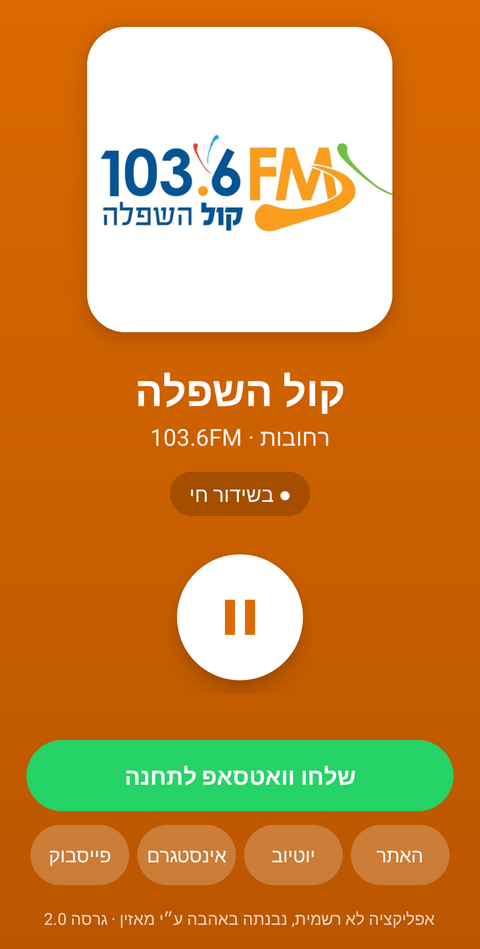

<p align="center">
  
</p>

# 📻 קול השפלה 103.6FM - Android app

> ⚠️ **Unofficial.** A fan app built by a listener. Not affiliated with Radio Kol Hashfela / 103.6FM.

A one-button Android app for [Radio Kol Hashfela 103.6FM](https://www.1036kh.com/) in Rehovot. Open it and the station plays. No ads, no tracking, no accounts.

**Download page (share this link):** https://brchn6.github.io/radio-kol-hashfela/

<p align="center"></p>

## What it does

- Starts playing the live stream as soon as you open it.
- Keeps playing with the screen off or in other apps, with Stop in the notification and the station logo on the lock screen.
- Pauses for phone calls and navigation prompts (Waze, Maps) and resumes by itself afterwards.
- Stops when headphones are unplugged or another app starts playing music.
- Reconnects by itself when the network drops: immediately when a network comes back or Wi-Fi/mobile data switches, otherwise retrying every 2s, 4s, 8s ... up to 30s.
- One-tap WhatsApp message to the station, plus links to its Facebook, Instagram, YouTube and website.
- Look modelled on the station's original iPhone app: orange background, logo card, big play button.

## Permissions

| Permission | Why |
|---|---|
| `INTERNET` | play the stream |
| `ACCESS_NETWORK_STATE` | reconnect the moment the internet comes back (Wi-Fi / mobile switch, no signal) |
| `FOREGROUND_SERVICE`, `FOREGROUND_SERVICE_MEDIA_PLAYBACK` | keep playing in the background |
| `POST_NOTIFICATIONS` | the Play/Stop notification (Android 13+) |
| `WAKE_LOCK` | keep Wi-Fi awake while streaming with the screen off |

No camera, microphone, contacts, location, storage or phone state.

## Build

Requirements: Android SDK command-line tools at `~/Android/Sdk` with `platforms;android-35` and `build-tools;35.0.0`, and JDK 17 at `~/tools/jdk17` (override with `ANDROID_HOME` / `JAVA_HOME`). No Gradle; Media3 (ExoPlayer) JARs are bundled in `libs/`.

```bash
# Compile check, no signing (this is what CI runs)
UNSIGNED=1 ./build.sh

# Signed release APK -> build/KolHashfela.apk
./build.sh
```

### The release signing key

Release APKs are signed with a private key kept outside the repo, so nobody else can publish an APK that installs over this app.

- Location: `~/.secrets/radio-kol-hashfela/release.keystore` and `keystore.pass` (mode 0600). Override with `RADIO_KEYSTORE` / `RADIO_KEYSTORE_PASS_FILE`.
- Created once with `scripts/make-release-key.sh` (refuses to overwrite an existing key).
- **Back both files up.** If they are lost, no future version can install as an update; every user would have to uninstall and reinstall.
- Certificate SHA-256: `4A:83:6E:06:2F:5E:5E:F9:1F:CF:43:FA:0A:F9:A6:E3:1F:2E:53:29:BC:0E:99:73:86:DC:81:2E:30:9E:4B:3F` (also shown on the download page).
- `./build.sh` refuses to sign if the key is missing. It never generates a throwaway key.

## Test on a phone

```bash
adb devices                                   # phone listed as "device"
adb install -r build/KolHashfela.apk
adb shell am start -n io.github.brchn6.kolhashfela/com.radioapp.MainActivity
adb logcat -s RadioService                    # playback log
```

Expected: the app opens orange with the logo, shows "מתחבר…" with a spinner, then "● בשידור חי" and audio plays. The notification shows the logo with a Stop button.

## Publishing a new version

1. Bump `android:versionCode` (+1) and `android:versionName` in `AndroidManifest.xml`. Phones refuse an update with the same or lower versionCode.
2. `./build.sh` and test on a phone.
3. Commit and push.
4. Upload the APK. The asset **must** be named `KolHashfela.apk`, because the download page links to `releases/latest/download/KolHashfela.apk`:

```bash
gh release create v2.0 build/KolHashfela.apk --title "v2.0" --notes "What changed" --latest
```

5. Check the link downloads the new file: `curl -sIL https://github.com/brchn6/radio-kol-hashfela/releases/latest/download/KolHashfela.apk | grep -i '^location' | tail -1`

## Download page

`site/` is a static Hebrew page (download button, install steps, link preview image for Facebook/WhatsApp). The workflow `.github/workflows/pages.yml` publishes it to GitHub Pages on every push that touches `site/`.

- One-time setup: repo Settings → Pages → Source: **GitHub Actions**.
- Preview locally: open `site/index.html` in a browser.
- `site/og.png` (1200x630) is the image Facebook shows when the link is shared. After changing it, refresh Facebook's cache at https://developers.facebook.com/tools/debug/ .

## Project layout

| Path | What |
|---|---|
| `src/com/radioapp/MainActivity.java` | The screen: logo card, play button, WhatsApp and links; reads state from the service |
| `src/com/radioapp/RadioService.java` | Foreground service: ExoPlayer, audio focus, reconnect, notification, lock-screen media session |
| `res/` | Hebrew strings, colors, theme, vector icons, launcher icon (adaptive), station logo |
| `AndroidManifest.xml` | App ID `io.github.brchn6.kolhashfela`, version, permissions |
| `build.sh` | aapt2 → javac → d8 → zipalign → apksigner |
| `scripts/make-release-key.sh` | One-time private signing key creation |
| `site/` | Download page for GitHub Pages |
| `.github/workflows/build.yml` | CI compile check on every push (does not publish) |
| `docs/audiotag-evaluation.md` | Earlier song-recognition experiments (not in the app) |

Stream: `https://radio.streamgates.net/stream/1036kh` (AAC+ 64 kbps). The app shows song titles from the stream's ICY metadata if the station ever sends real ones (today it sends only a generic placeholder, which is hidden).

## License

Do whatever you want with the code. This is for the love of radio. The station name and logo belong to Radio Kol Hashfela.
